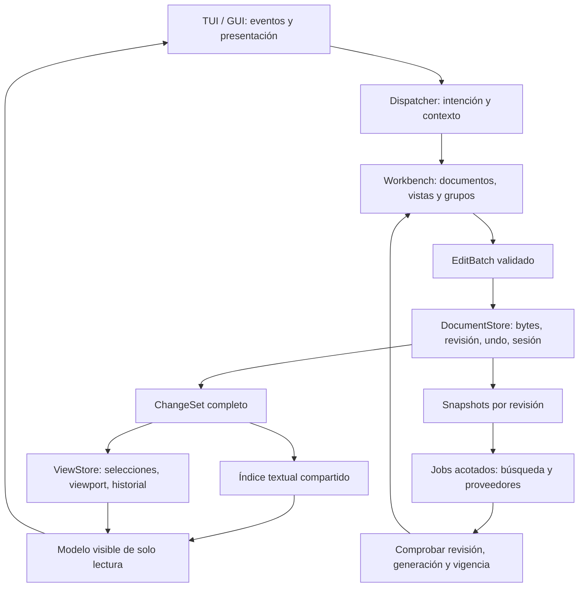

# Auditoría de arquitectura y referencia ecode

Fecha: 2026-11-01. Base de JC-IDE: `d5eccfccdfade62b6f794d48b2e3a25de945d4ca`, rama `m2a/dual-pane-tui`.

**Seguimiento:** [F1 implementado](F1_DOCUMENT_VIEWS_TRANSACTIONS.md) corrige propiedad duplicada, transacciones, CRLF y apertura/cierre. Este informe conserva los hallazgos y tiempos de la base auditada; no describe esos defectos como presentes después de F1. F2/F3 siguen pendientes.

## Dictamen

La base de bytes, encoding explícito, guardado y comandos merece conservarse. La integración actual de edición/vistas/render es un prototipo funcional y todavía no una base optimizada para la GUI. Antes de ampliar navegación ABL, Git o asistentes hay que sustituir la sincronización de estados duplicados, introducir transacciones de edición y sacar la decodificación completa de las rutas de movimiento y dibujo.

Esto afecta también al incremento de doble panel recién realizado: comparte correctamente buffer e historial, pero conserva cursor/selección/scroll tanto en `EditorDocument` como en `PaneView`. Sus 78 pruebas locales no demuestran que esa arquitectura escale ni que todos los flujos sean correctos.

“Construir desde el inicio” se concreta en definir propietarios de estado, contratos de cambio y presupuestos antes de añadir más funcionalidades. No exige descartar las garantías de conservación de archivos ya construidas. Las sustituciones deben retirar el mecanismo anterior en cada incremento; no añadir una tercera copia del estado ni otro editor dentro de la GUI. La optimización máxima no es certificable sin cargas, hardware y mediciones: el objetivo verificable será cumplir los presupuestos del plan.

## Alcance y fuentes fijadas

Se revisaron las rutas locales de documento, interpretación, Workbench, vistas, búsqueda, pestañas, entrada y render TUI. Se ejecutó un ejemplo diagnóstico sobre datos sintéticos. No es una auditoría exhaustiva de seguridad, de todas las combinaciones de edición ni de las plataformas soportadas.

El repositorio [SpartanJ/ecode](https://github.com/SpartanJ/ecode/tree/ae0a5cda57c11a3f074eb383708a3dfb017ec4df) contiene documentación y recursos; su README remite a la implementación en **SpartanJ/eepp**. Para no confundir una página de producto con código revisado, las referencias de abajo fijan `eepp` en `d35cbfed51a7aefa994953bbfa0d1bf373445cb5` (rama `develop` consultada ese día). Se inspeccionaron rutas concretas del editor, splits, undo, búsqueda, palette, plugins, Git y layout. No se compiló ni se midió ecode; no se afirma que sea más rápido que JC-IDE.

| Tema | Evidencia en ecode/eepp | Aplicación a JC-IDE |
|---|---|---|
| Split sin clonar el documento | [uicodeeditorsplitter.cpp, creación de otro editor](https://github.com/SpartanJ/eepp/blob/d35cbfed51a7aefa994953bbfa0d1bf373445cb5/src/eepp/ui/tools/uicodeeditorsplitter.cpp#L716-L743) comparte `getDocumentRef()` | Un `DocumentId` puede tener varios `ViewId`; un historial de contenido por documento. |
| Documento y proyección visual | [documentview.hpp](https://github.com/SpartanJ/eepp/blob/d35cbfed51a7aefa994953bbfa0d1bf373445cb5/include/eepp/ui/doc/documentview.hpp) distingue índices visibles, wrap y cachés | Separar índice textual compartido de layout por vista. No copiar literalmente la ubicación de selecciones: [UICodeEditor las consulta en TextDocument](https://github.com/SpartanJ/eepp/blob/d35cbfed51a7aefa994953bbfa0d1bf373445cb5/src/eepp/ui/uicodeeditor.cpp#L329-L377). |
| Dibujo por rango visible | [uicodeeditor.cpp](https://github.com/SpartanJ/eepp/blob/d35cbfed51a7aefa994953bbfa0d1bf373445cb5/src/eepp/ui/uicodeeditor.cpp#L312-L425) obtiene rangos y descarta líneas fuera de pantalla | Consultar líneas visibles e invalidar por cambios, sin crear todas las líneas en cada frame. |
| Invalidation y espera | [ecode.cpp, mainLoop](https://github.com/SpartanJ/eepp/blob/d35cbfed51a7aefa994953bbfa0d1bf373445cb5/src/tools/ecode/ecode.cpp#L993-L1019) dibuja al invalidar y espera eventos en reposo | Mantener reposo eficiente y añadir eventos de tareas. La TUI actual ya bloquea esperando teclado; su defecto es el trabajo por evento, no un bucle de CPU en reposo. |
| Cachés de texto/sintaxis | [syntaxhighlighter.cpp](https://github.com/SpartanJ/eepp/blob/d35cbfed51a7aefa994953bbfa0d1bf373445cb5/src/eepp/ui/doc/syntaxhighlighter.cpp) invalida y reutiliza estado por línea | Claves de revisión, encoding y configuración; propagación hasta estabilizar estado léxico. No asumir que toda caché de ecode es incremental: [DocumentView::invalidateCache](https://github.com/SpartanJ/eepp/blob/d35cbfed51a7aefa994953bbfa0d1bf373445cb5/src/eepp/ui/doc/documentview.cpp#L94-L125) puede recorrer todas las líneas. |
| Búsqueda de proyecto | [projectsearch.cpp](https://github.com/SpartanJ/eepp/blob/d35cbfed51a7aefa994953bbfa0d1bf373445cb5/src/tools/ecode/projectsearch.cpp#L260-L390) usa pool, filtros, cancelación, tabla BMH reutilizada y documentos sucios abiertos | Preferir snapshot abierto al disco, una generación por consulta, concurrencia y colas acotadas. La ruta revisada acumula resultados hasta terminar: JC-IDE necesita además lotes progresivos y cuotas explícitas. |
| Comandos y palette | [commandpalette.cpp](https://github.com/SpartanJ/eepp/blob/d35cbfed51a7aefa994953bbfa0d1bf373445cb5/src/tools/ecode/commandpalette.cpp), [universallocator.cpp](https://github.com/SpartanJ/eepp/blob/d35cbfed51a7aefa994953bbfa0d1bf373445cb5/src/tools/ecode/universallocator.cpp) | Conservar registro único y búsqueda de comandos/archivos/símbolos con destinos tipados; el frontend aporta intención y contexto. |
| Servicios opcionales | [pluginmanager.cpp](https://github.com/SpartanJ/eepp/blob/d35cbfed51a7aefa994953bbfa0d1bf373445cb5/src/tools/ecode/plugins/pluginmanager.cpp), [autocompleteplugin.cpp](https://github.com/SpartanJ/eepp/blob/d35cbfed51a7aefa994953bbfa0d1bf373445cb5/src/tools/ecode/plugins/autocomplete/autocompleteplugin.cpp) | Trabajos fuera del hilo de UI y entrega condicionada por revisión/generación. Preparar capacidades internas; no importar ahora su ecosistema completo de plugins. |
| Git y presentación | [git.cpp](https://github.com/SpartanJ/eepp/blob/d35cbfed51a7aefa994953bbfa0d1bf373445cb5/src/tools/ecode/plugins/git/git.cpp), [applayout.xml.hpp](https://github.com/SpartanJ/eepp/blob/d35cbfed51a7aefa994953bbfa0d1bf373445cb5/src/tools/ecode/applayout.xml.hpp) | Consultar separación de proveedor, proceso y layout. Para JC-IDE usar argumentos estructurados, snapshots inmutables y operaciones read-only en M2; su alcance funcional no altera nuestro calendario. |

### Lo que no se traslada

- **Modelo textual normalizado.** La [carga de TextDocument](https://github.com/SpartanJ/eepp/blob/d35cbfed51a7aefa994953bbfa0d1bf373445cb5/src/eepp/ui/doc/textdocument.cpp#L600-L674) transforma finales a una representación interna con LF y añade terminadores internos. Es distinto del contrato canónico de bytes de JC-IDE. Esto no es una afirmación de pérdida de datos al guardar en ecode; no se auditó su roundtrip completo.
- **Undo agrupado solo por tiempo.** [TextUndoStack](https://github.com/SpartanJ/eepp/blob/d35cbfed51a7aefa994953bbfa0d1bf373445cb5/src/eepp/ui/doc/textundostack.cpp#L130-L218) combina comandos cercanos mediante un umbral de 300 ms. JC-IDE necesita una transacción explícita para replace-all, selección rectangular y propuestas de proveedores; la agrupación de escritura continua será una política adicional.
- **Stack gráfico C++ completo.** Referenciar una solución no justifica añadir EEPP, GPU, LSP ni una runtime de plugins al núcleo Rust. Cada dependencia debe resolver un requisito comprobado.

No se portó código de ecode en esta auditoría. La [licencia raíz de eepp](https://github.com/SpartanJ/eepp/blob/d35cbfed51a7aefa994953bbfa0d1bf373445cb5/LICENSE) es MIT; un port futuro debe registrar archivos, revisión y avisos aplicables, incluidas dependencias con licencia propia.

## Hallazgos de JC-IDE

Las líneas indicadas corresponden al commit base. **P1** bloquea el siguiente crecimiento funcional; **P2** debe resolverse en la base M2 antes de declarar aceptación. “Reproducido” significa ejecución del ejemplo adjunto; “estático” identifica una ruta de código, no una prueba de interfaz realizada.

| ID / prioridad | Evidencia e impacto | Sustitución requerida y aceptación |
|---|---|---|
| A1 / P1 | **Reproducido y estático.** `workbench/edit.rs:150` copia/decodifica todo el documento para mover el cursor; `workbench/mod.rs:128,493` y `jc-text/index.rs:45` reconstruyen texto e índice para posiciones. `jc-tui/render/mod.rs:271,284,444` repite ese trabajo y crea todas las líneas. La respuesta crece con N aun con viewport fijo. | Índice de líneas por revisión y acceso a segmentos/rangos, cachés acotadas compartidas y layout visible por vista. Eliminar `to_bytes()` + decode global del movimiento/dibujo estable. Verificar contadores de bytes visitados/asignaciones además de tiempos. |
| A2 / P1 | **Estático.** `workbench/mod.rs:70` y `panes.rs:37` poseen cursor/selección/scroll; `record_active_pane_cursor`/`restore_location` los copian al cambiar foco. `active_document_mut` permite saltarse la notificación de cambios. `TabId` representa a la vez documento y presentación. | `DocumentStore`, `ViewStore`, grupos con listas de vistas; estado editable de vista en un solo sitio. Retirar campos espejo y mutación pública del buffer en consumidores. Split debe compartir sesión/undo y conservar selecciones independientes después de edit/undo/redo/cierre. |
| A3 / P1 | **Reproducido.** `workbench/search.rs:104` llama a `Document::replace` por coincidencia. `a a` → replace-all `b` → `b b` → un undo produce **`a b`**. `last_edit` representa solo un reemplazo. Un error intermedio tampoco tiene rollback de lote. | `EditBatch` validado contra revisión, aplicación atómica, un undo y `ChangeSet` completo. Validar todos los rangos, encoding, solapes y capacidad antes del commit; fallo recuperable deja bytes, revisión e historial intactos. |
| A4 / P1 | **Reproducido.** Con `a\r\nb`, dos Right sitúan cursor en byte **2**, entre CR y LF; `active_position()` devuelve `None`. `jump_to_location(tab,2)` también acepta esa posición porque valida límites escalares, no de edición. | Un servicio común de límites de edición/texto; CRLF indivisible para navegación y borrado textual. Tipos distintos para bytes, escalares, grafemas y columnas de terminal/GUI. No normalizar bytes para ocultar el problema. |
| A5 / P2 | **Reproducido y estático.** `Document` limita pasos, no bytes retenidos. Con historial cero y 100 reemplazos de 64 KiB conserva **6.25 MiB** añadidos para un documento de 64 KiB. `compact_storage()` libera pero borra historial. Snapshots guardan vectores de piezas; la lista de cerrados retiene documentos completos. No es prueba de fuga, sí de retención sin presupuesto de bytes. | Presupuesto conjunto para undo/redo, buffers añadidos, snapshots y cerrados; liberar segmentos no alcanzables. Comparar vector indexado por bloques con árbol aumentado antes de elegir estructura. No compactar perdiendo undo silenciosamente. |
| A6 / P2 | **Reproducido.** `close_active(true)` conserva documento sucio para reapertura; `tabs.rs:136` pone `dirty=false`. Tras reabrir: contexto **sucio**, pestaña **limpia**. | Derivar indicador de revisión guardada del documento. Separar “descartar cambios” de “recuperar borrador”; reabrir tras descarte debe seguir la política explícita y coherente, incluidos documentos sin archivo. |
| A7 / P1 | **Estático.** `jc-tui/app/paths.rs:16` abre por prompt; `open_path` solicita encoding, pero la rama de éxito de `submit_prompt` ejecuta `close_overlay` inmediatamente y reemplaza el estado mostrado. Puede desaparecer la elección legacy. | Transición `Opening → NeedsEncoding → Ready/Failed`, no cierre genérico posterior que invalide el siguiente diálogo. Prueba de eventos con archivo no UTF-8 sin encoding configurado. |
| A8 / P2 | **Estático.** `render/mod.rs:10` modifica viewport mientras dibuja; `terminal.rs:31` limpia y emite pantalla completa. El bucle `lib.rs:21` espera solo entrada de terminal y no incorpora finalizaciones de tareas. | Actualización de estado antes del render; snapshot de presentación de solo lectura; diff de celdas con redraw total en resize/invalidación. Integrar entrada, cancelación y resultados de jobs sin busy loop ni esperar otra tecla. |
| A9 / P1 para Search Plus | **Estático.** `workbench/search.rs` reconstruye búsqueda síncrona al editar; `search_match_position` decodifica otra vez por resultado. El panel crea filas para todas las coincidencias (`render/mod.rs:338`): puede multiplicar trabajo por coincidencias × tamaño del archivo. No existe aún motor de proyecto acotado. | Preparar posición/extracto sobre un índice compartido y virtualizar filas; resultados ligados a documento/revisión/consulta. Pool y canales acotados, backpressure y cancelación; reemplazo de proyecto con preview y validación de cada archivo. |
| A10 / P2 | **Estático/documental.** La base tiene buen registro de comandos, pero el frontend aún elige rutas especiales de negocio, p. ej. Open to Side del Explorer. El plan pedía tareas Progress completas en M2A y nuevamente en M3; aplazaba mediciones a hardening. | El frontend aporta `NavigationTarget` y parámetros; el dispatcher decide apertura/pin/historial. Corregir hitos: contratos de tareas en M2, ejecución AVM en M3, medición local desde M2. CI sigue M5. |

Rutas abreviadas de la tabla: `workbench/*` está en `crates/jc-app/src/workbench/`; `panes.rs` y `tabs.rs` en `crates/jc-app/src/`; los archivos de texto/core en sus respectivos `crates/*/src/`. El fallo A4 es de integración: `TextIndex` sí detecta `InsideLineEnding`, pero la navegación no usa esa restricción.

### Qué conservar

- Bytes canónicos independientes de su interpretación; codecs explícitos y errores de representación sin edición parcial.
- `FileSession`, detección de conflicto y guardado seguro. Sus pruebas históricas se conservan; no se declara revalidación completa de M1 por esta auditoría.
- Separación `jc-core` / `jc-text` / `jc-files` / `jc-app`, perfiles declarativos y frontera opcional de Progress.
- Un undo por documento, registro de comandos, keymap por contexto, reglas de foco y casos de prueba útiles del doble panel.
- TUI como consumidor y banco de flujos. La GUI debe probar el mismo motor; la TUI no es el molde visual final.

## Medición local inicial

Ejemplo reproducible: `crates/jc-app/examples/audit_baseline.rs`. No escribe archivos de usuario, no inicia servicios ni cambia el comportamiento del editor. Es diagnóstico opt-in, no un test que aprueba los fallos conocidos.

```powershell
.\scripts\cargo-local.ps1 run -p jc-app --example audit_baseline --release --locked --offline
```

Entorno: Windows local, Rust 1.85.1 MSVC; perfil existente `opt-level="s"`, LTO thin, un codegen unit. Texto UTF-8 ASCII de líneas de 8 bytes (`abcdefg\n`), 5 operaciones de calentamiento y 31 muestras ordenadas por operación; p50 índice 15 y p95 índice 29. Preparación del documento fuera del cronómetro, sin búsqueda activa ni render. Una corrida en la máquina del usuario; no se registró aquí inventario de hardware ni aislamiento de carga.

| Tamaño | Right p50 | Right p95 | Posición p50 | Posición p95 |
|---|---:|---:|---:|---:|
| 4 KiB | 0.050 ms | 0.055 ms | 0.074 ms | 0.141 ms |
| 64 KiB | 0.630 ms | 0.906 ms | 1.037 ms | 1.212 ms |
| 1 MiB | 8.540 ms | 12.067 ms | 15.000 ms | 21.492 ms |
| 4 MiB | 36.929 ms | 43.371 ms | 62.662 ms | 77.625 ms |

Estos tiempos aíslan dos llamadas del modelo; **no son latencia tecla-a-pantalla, RAM total, arranque ni comparación contra ecode/Sublime**. El perfil observado y las rutas de código justifican eliminar los recorridos globales, pero no elegir todavía un toolkit gráfico o prometer un factor exacto de mejora. Repetir después de la migración, añadir líneas muy largas, UTF-8, legacy, muchas piezas y dos vistas, y medir asignaciones/RAM/end-to-end.

## Arquitectura de destino

Contratos y propietarios detallados en [ARQUITECTURA.md](ARQUITECTURA.md). Los nombres siguientes son diseño pendiente, no APIs ya implementadas.



Flujo de edición: validar intención y encoding → preparar lote sobre revisión esperada → publicar un cambio atómico → reubicar todas las vistas mediante el mismo mapa → invalidar índices/cachés afectados → producir presentación visible. Undo/redo emiten el mapa inverso/directo de la transacción completa.

Flujo de apertura: identificar documento existente por ruta/identidad → cargar y resolver encoding si falta → asociar una vista al grupo conforme a pin/foco → restaurar viewport → renderizar. Cerrar una vista no destruye un documento todavía referenciado; cerrar el último consumidor aplica la política de cambios pendientes.

Flujo de búsqueda: capturar consulta y snapshots/revisiones → recorrer fuentes con cuotas → entregar lotes → descartar generaciones viejas → navegar por destino tipado. Los workers no editan buffers vivos; una propuesta de cambio vuelve al dispatcher y se valida de nuevo.

## Dirección visual: Sublime Text

Sublime sigue siendo la referencia visual y de fluidez, ecode una referencia adicional de implementación. La [página oficial de Sublime Text](https://www.sublimetext.com/) muestra pestañas, divisiones y navegación lateral; no se dispone de su código propietario para esta auditoría.

El primer prototipo gráfico debe mostrar: marco discreto y compacto, editor dominante, pestañas sobrias por grupo, árbol lateral colapsable, gutter y tipografía monoespaciada legible, palette flotante centrada, búsqueda inferior, barra de estado con encoding/EOL/posición y referencia dividida con foco perceptible. Tema y métricas deben ser datos, no reglas de negocio. Minimap, si aporta valor, llegará después sobre un resumen cacheado; no justifica recorrer todo el documento en cada frame.

Comparar capturas y uso real con un caso único: fuente ABL + include anclado + búsqueda + palette; probar escalas Windows 100/150/200 %, foco por teclado, IME y contraste. No confundir aspecto similar con compatibilidad de plugins ni importar shortcuts que contradigan los acordados (Ctrl+D continúa duplicando). La compatibilidad de paquetes/Python permanece post-M5.

## Orden de ejecución y condiciones de salida

1. **F0 — Evidencia (esta entrega).** Auditoría, diagnóstico reproducible, plan y contratos corregidos. No se declaran reparados los fallos A1–A10.
2. **F1 — Propiedad y transacciones.** Crear identidades documento/vista/grupo, retirar estados espejo y APIs de mutación sin notificación, introducir `EditBatch`/`ChangeSet`, corregir A3/A4/A6/A7. Regresiones de replace-all + undo, fallo de lote, CRLF, legacy prompt, descarte y dos vistas con historial compartido.
3. **F2 — Acceso incremental y memoria.** Acceso a segmentos, índice de líneas actualizado por cambio, cachés con presupuesto, límites de historial por bytes. Comparar estructuras con la misma carga antes de sustituir almacenamiento; conservar API y pruebas byte-preserving. Mostrar bytes recorridos y RAM retenida, no solo promedios.
4. **F3 — Presentación y tareas.** Render visible de solo lectura, diff de terminal y jobs con resultados versionados. Medir tecla-a-pantalla y cancelación. Se puede iniciar el prototipo GUI tras estabilizar F1/F2; no esperar a completar toda la asistencia ABL.
5. **M2 producto.** Search Plus de proyecto, destinos genéricos y Git read-only sobre los contratos nuevos. Elegir backend GUI con evidencia y mantener lenguaje/servicios opcionales. M3/M4 incorporan proveedores ABL; M5 endurece multiplataforma/CI/Git con escritura.

No se construyen dos motores finales en paralelo. Cada incremento migra sus consumidores y elimina la ruta sustituida; el resto queda operativo. No se acepta un cambio de contenedor, una caché global del archivo entero o agrupar undo por temporizador como solución suficiente a todos estos hallazgos.

Los criterios medibles y límites de los hitos están en [PLAN.md](PLAN.md). Los registros históricos de tests continúan en [VALIDACION.md](VALIDACION.md); prueban sus casos, no la inexistencia de los defectos descubiertos aquí.
