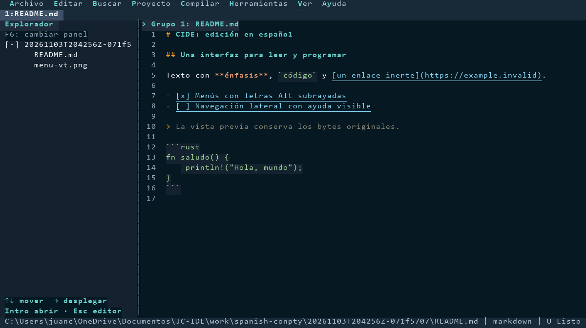
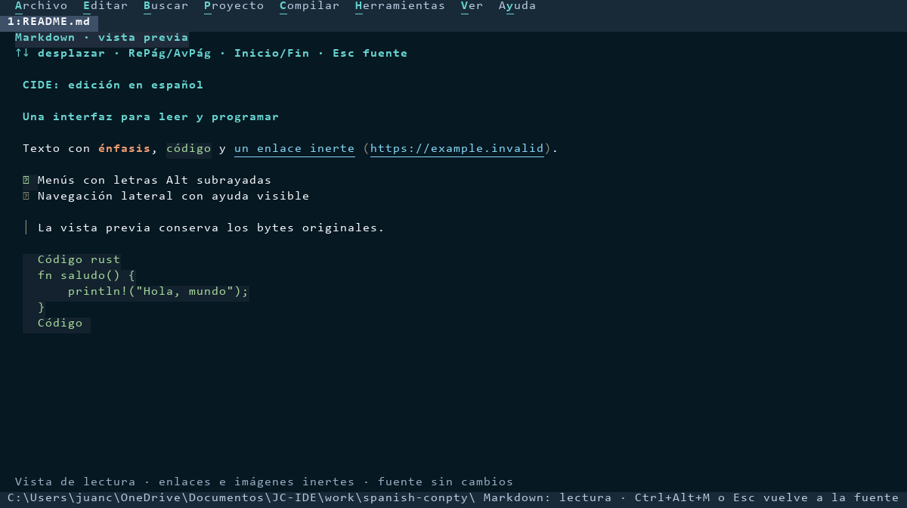

# GUI y TUI en español — cierre local, 2026-11-03

Construcción sobre `a38881a`. Juan pidió continuar los pendientes GUI empezando
por comparación de abiertos y después dirigió el bloque a color/navegación/Markdown
de TUI y español en ambas interfaces. Es un bloque completo de presentación y
flujos sobre F1/F2/F3; conserva un único modelo editable. La construcción y
validación local están cerradas; la aceptación física/global sigue abierta.

## Uso

- GUI: **Ver → Preferencias de apariencia** ajusta por separado el tamaño base
  de la interfaz y del editor. Los tamaños iniciales son 12 y 15 píxeles
  lógicos. En el mismo selector se puede mostrar u ocultar el minimapa y
  elegir su ancho. El ancho inicial es de 160 píxeles lógicos y se puede
  ampliar a 200. El minimapa se estrecha cuando el grupo tiene menos espacio.
- GUI: **Ver → Zoom del editor** y el porcentaje de la barra inferior abren
  la misma escala, del 60 % al 200 %. El zoom cambia el texto del editor
  sobre su tamaño base. Las preferencias se recuperan al reabrir la sesión.
- El minimapa muestra el código en miniatura con sangrías y colores de
  sintaxis. Un clic lleva a la zona elegida y se puede arrastrar el marco
  del área visible. Las muestras acotadas se colorean como fragmentos por
  línea. En ABL, palabras clave, tipos y valores lógicos tienen colores
  distintos en el editor y en el minimapa.
- TUI: F10 abre los menús; Alt+A Archivo, Alt+E Editar, Alt+B Buscar, Alt+P Proyecto,
  Alt+C Compilar, Alt+H Herramientas, Alt+V Ver, Alt+Y Ayuda. Las letras reales se
  subrayan siempre. Flechas recorren menús, Intro acepta, Esc vuelve al editor.
- Explorador: la vista muestra F6 para cambiar panel, flechas para recorrer y
  desplegar, Intro para abrir y Esc para regresar. Ctrl+Intro abre al lado.
- Markdown: fuente resaltada y Ver / Vista previa de Markdown, también Ctrl+Alt+M.
  Flechas/RePág/AvPág/Inicio/Fin desplazan la lectura; Esc vuelve a la fuente, F5
  recaptura contexto si quedó obsoleto. Funciona en TUI y GUI.
- GUI: mostrar dos documentos distintos en grupos y Ver / Comparar grupos abiertos
  (solo lectura). Flechas eligen bloque, RePág/AvPág recorren contexto, Intro navega
  al grupo derecho y Mayús+Intro al izquierdo. F5 actualiza, Esc cancela/cierra.
- GUI: Símbolos y Referencias del documento usan el proveedor léxico opcional;
  Completar palabra local (Ctrl+Espacio) propone palabras anteriores al cursor.
  Aceptar es explícito, con una transacción; no semántica o PROPATH simulado.
- GUI: Insertar plantilla / Envolver selección abre elección, parámetros y vista
  previa. Intro/Tab avanza, Mayús+Tab vuelve, F2 edita y F9/Ctrl+Intro aplica.
  Esc cancela sin cambiar fuente. El catálogo ABL es metadata del proveedor.

## Propiedad y presupuestos

Comparación usa OpenDiffController/OpenDiffView existentes: dos snapshots
inmutables <=2MiB/lado, admisión dual F3, un trabajo y metadata pendiente, resultado
versionado por ambos documentos/vistas/encodings/rutas. Sin Git, merge o escritura.
La GUI consume filas tipadas, contexto acotado y modo lateral/unificado según ancho;
no revela/prepara editores cubiertos. Colores distinguen altas/bajas y encabezados.

SourceController comparte el único poll F3 con Git/OpenDiff y los paneles de tareas.
Workers no reciben Workbench ni escriben. Resultados obsoletos/cancelados se descartan;
la cola conserva reconocimiento de solicitudes reemplazadas. Referencias ambiguas
exigen selección confinada y el destino conserva su encoding. SnippetSession aplica
revisión esperada y un undo; todo el wizard anterior es inmutable respecto al fuente.
El paste de parámetros libera el préstamo antes del clipboard OS y revalida intención
de campo y fuente al regresar. Las pruebas usan únicamente transporte sintético.

Markdown es un subconjunto de lectura inerte, con encabezados, énfasis, código,
listas/tareas, citas, enlaces/imágenes textuales y tablas sencillas. No CommonMark
completo, HTML/JavaScript, navegador, descargas o apertura automática de enlaces.
El lexer usa continuación de tamaño fijo sobre bytes y el caché de sintaxis existente.
La vista lee líneas/rangos, no copia/decodifica todo el documento para desplazarlo.
Hasta128 filas/256 columnas,16KiB por línea y256KiB de lectura por preparación;
navegación de hasta128 pasos/2MiB de líneas y contexto léxico acotado aparte.
Líneas/encoding/contexto no admitidos muestran diagnóstico y conservan fuente.
Desplazamiento visual y revisión son metadata de la vista, sin otro buffer/undo.

## Dirección visual y español

Referencia real consultada en OmniCore:
`C:/Users/juanc/source/repos/OmniCore/src/OmniCore.Cli/Tui/TuiTheme.cs` y
`MarkdownRenderer.cs`. Se usa su jerarquía de fondos azul oscuro y acento turquesa,
foco/selección legibles y spans Markdown; implementación nueva Rust, sin portar
Terminal.Gui/Markdig ni agregar dependencias externas. GUI mantiene el marco
compacto y oscuro de la dirección visual Sublime Text.

El tema TUI es semántico: menú, mnemónico, panel, encabezado, estado, foco y sintaxis.
Cell conserva su tamaño y FrameEncoder compara atributos/payload, emite RGB de
frente/fondo y subrayado, limpia atributos entre roles y no redibuja un frame idéntico.
NO_COLOR conserva navegación/subrayados/contraste sin emitir RGB.

Se traducen etiquetas, ayudas, estados y errores propios de ambas interfaces.
Los IDs, bindings técnicos, nombres de API/codificación, fuente del usuario,
cuerpos de plantillas y diagnósticos devueltos por herramientas/sistema conservan
su significado original. La presentación de UI española se separa del escape
diagnóstico de rutas/bytes; no convertir acentos visibles en secuencias de escape.
No se cambia idioma/configuración de Windows ni de otras aplicaciones.

## Validación observada

Rust1.85.1/MSVC x64 existente, offline: formato, Clippy de todos los targets con
warnings como errores y compilación release de bins/examples aprobados. Se listan
551 nombres distintos:549 aprobados por suites y cierres dirigidos, dos helpers
Git ignorados como tests independientes y ejecutados por sus padres. Son19 casos
nuevos; no se afirma una ejecución global única de todos los tests.
[Inventario y cobertura](evidence/ui-es-gui-2026-11-03-coverage.json).

Release en `target/ui-es/release` conserva el ejecutable anterior que Juan está
probando. Cuatro recorridos ConPTY aprobaron menús RGB/subrayados, ayuda/foco
lateral, Markdown de solo lectura y resize compacto;58733 bytes VT capturados.
El recorrido HWND aprobó15 checks (ocho de flujos nuevos y siete comunes), sin
errores de pintura ni cambios en los fixtures o metadata Git. Comprobó comparación
sin Git, navegación/refresh/cancelación, resultados obsoletos, fuente opcional,
completado/plantillas con un undo y Markdown/foco/paleta. El tiempo del harness
no mide latencia física de UI. No se accedió al clipboard personal ni se inició AVM.

Se conservan los fallos iniciales y sus cierres: expectativas en inglés, un fixture
de texto traducido accidentalmente (restaurado), contrato de reset Dim, lint/fmt
y nombres antiguos en el runner HWND. Este último falló aun pasando los ocho
checks del producto; el runner corregido aprobó el recorrido final. El rasterizador
VT también conservaba colores al borrar celdas; se corrigió y las capturas finales
se revisaron visualmente. Capturas de celdas VT y DIB propios acreditan composición
y atributos, no una pantalla física.

Metadatos, hashes y reporte del ZIP de desarrollo:
[evidencia del bloque](evidence/ui-es-gui-2026-11-03-metadata.json).

Aceptación física/global RAM/arranque/latencia, IME/DPI/accesibilidad y clipboard
entre aplicaciones siguen abiertas. OpenEdge real M3 y semántica M4 requieren sus
proveedores/entorno; Git con escritura y CI M5, runtime externo post-M5. No se amplía
el alcance a shell embebido o gestos sin contrato por llamar «completa» a la GUI.
