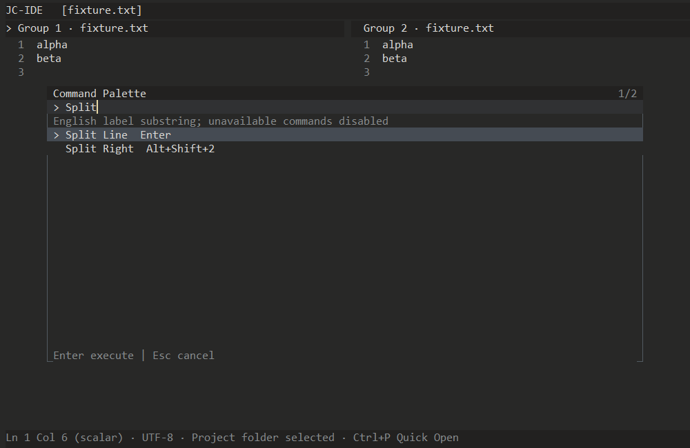

# M2B — Quick Open y Command Palette nativos

Bloque funcional sobre el primer frontend Win32/GDI. Reutiliza Workbench,
CommandRegistry/KeyMap y QuickOpenController; no introduce otro documento editable
ni dependencias de terceros. La validación local se registra al cerrar el bloque.

## Flujo

File / Open Folder (Ctrl+Shift+O) selecciona una carpeta mediante el Shell de
Windows. También se admite `--project-root DIR`, con ruta nativa y canonicalización
explícita. No crea watcher ni índice. El diálogo se ejecuta en el hilo UI, sin
préstamo del modelo mientras su loop modal puede reentrar la ventana.

Ctrl+P abre Quick Open. La consulta se limita a256 bytes UTF8, rechaza controles y
controles bidi, y usa la búsqueda de rutas por substring/case folding completo
del controller compartido. No lee contenido durante el scan. Flechas/Page/Home/
End seleccionan; Enter abre; Ctrl+Enter abre lateralmente; F5 renueva; Escape
cancela. Las cuotas, generaciones y lectura confinada por handle son las de
[Quick Open](M2_QUICK_OPEN.md), incluida la admisión16MiB para un nuevo documento.
Un documento ya abierto y modificado conserva su identidad/undo y no se recarga.

Ctrl+Shift+P abre Command Palette sobre el registro central. Filtra etiquetas
inglesas por substring ASCII sin distinción de mayúsculas; no promete fuzzy ni
el folding Unicode del finder. Los shortcuts se derivan del KeyMap, también en
los menús nativos. Las acciones no conectadas a este frontend se muestran
deshabilitadas y se vuelven a validar antes de ejecutar. Save All sigue pendiente
de su flujo nativo; no guarda documentos nuevos con nombres generados.

El selector es modal respecto a la edición: los caracteres modifican la consulta,
no el documento; Escape devuelve el editor sin alterar su selección/undo. La
entrada actual se agrega al final y Backspace retira un escalar; no es todavía
un campo con movimiento interno del caret, paste OS o composición IME. Los clicks
sobre el editor se ignoran mientras el selector esté abierto. Un comando de menú
cierra el selector antes de ejecutarse. Cambiar carpeta cancela y retira resultados.

## Entrega y composición

Wakeup conserva ticket/Condvar y añade un notifier opcional corto. Signal libera
el mutex del ticket antes de llamar al notifier; un pánico se captura y deja un
latch consumible. El callback no accede al modelo. La GUI lo conecta a PostMessage
de su propio HWND, con coalescencia: como máximo un mensaje pendiente por bridge.
No hay un hilo permanente que convierta notificaciones ni polling en reposo.

El propietario UI acepta completions únicamente al manejar TASKS_MESSAGE con la
carpeta/consulta actuales. Acknowledge ocurre antes del poll y readiness cierra
la carrera de publicación. Un mutex breve serializa PostMessage con detach antes
de liberar el HWND/State; ningún join ni préstamo del modelo ocurre bajo ese mutex.
Los errores de transporte se registran para mostrarse en la siguiente entrega;
si falla PostMessage no se garantiza despertar autónomo: F5 permite reintentar.

Prepare normaliza selección y copia solo las filas visibles (máximo32; popup
normal16), sin aceptar completions. El renderer recibe una presentación propia
inmutable: consulta acotada, mensaje y etiquetas de filas visibles. El popup limita
su geometría a96 columnas/20 filas y conserva la fila seleccionada al estrecharse.
Ni GDI ni el selector puro poseen Workbench, fuentes canónicas o historial.

## Alcance de la evidencia

El smoke del ejecutable real opera sobre HWND oculto/fixture propios. Bombea solo
TASKS_MESSAGE publicado por el worker para comprobar entrega sin otra tecla;
no llama directamente al poll como sustituto del transporte. Comprueba consulta
sin edición, apertura lateral de documento sucio/undo compartido, comando de
palette en una transacción, rechazo de acción no conectada, invalidación de raíz
y raster GDI de popup sin cambio de revisión.

El picker modal, interacción física, IME, OS clipboard, DPI y accesibilidad siguen
en la prueba de usuario posterior. Un bitmap GDI acredita composición del canvas,
no captura de pantalla física ni latencia tecla-a-pantalla. Regex permanece
aplazado, sin instalar/fijar nuevas dependencias. No se ejecuta CI remoto.

## Cierre local — 2026-11-02

Suite completa workspace offline: **350 pruebas Rust aprobadas**, cero fallos;
dos helpers de subprocess ignorados por el runner se invocan desde sus padres.
Incluye las3 pruebas nuevas de notifier y7 de input/presentación/geometría,
además del caso CLI project-root. Clippy workspace all-targets con warnings
denegados y release workspace bins/examples aprobaron. El primer intento de
compilación detectó un nombre de campo incorrecto solo en el smoke; se corrigió
antes de completar la suite. No se repitieron perfiles ni pruebas por documentación.

El release real pasó **23 checks nativos** en HWND propio oculto, incluyendo los
7 nuevos del selector/transporte. Reporta cero errores de pintura y conserva
exactamente el fixture de13 bytes. Canvas1000x650/162 colores, revisado visualmente.
wall_ms=12 es duración del smoke, no una medición de latencia física.

- [Reporte exacto](evidence/m2b-native-selectors-smoke-2026-11-02.json).
- [Hashes y procedencia](evidence/m2b-native-selectors-metadata-2026-11-02.json).
- [Canvas GDI](evidence/m2b-native-selectors-2026-11-02.png).

Siguiente bloque funcional M2B: clipboard nativo y selección gráfica explícita
de encoding. Construir ambas rutas antes de una nueva ventana de validación;
el clipboard del sistema no se toca desde el smoke del bloque actual.
