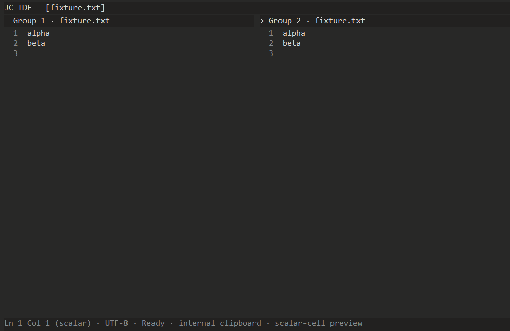

# M2B — Primer frontend nativo Windows

Estado: primer ejecutable real `jc-ide-gui` construido y ejecutado localmente
con HWND propio, mensajes nativos y GDI. No es prototypes/m2b ni una página HTML.
No cierra toda la aceptación de M2B ni acredita una prueba de pantalla física.
Juan autorizó avanzar M2A/M2B, ejecutar automatización posible al cerrar los
bloques y dejar las pruebas manuales para el final. Las puertas de aceptación
global siguen documentadas, sin bloquear construir este frontend.

## Backend y dependencias

Win32/User32 + GDI, con FFI directa a bibliotecas del sistema disponibles. No se
descarga ni instala un framework. El nuevo crate depende solo de jc-app/jc-text;
Cargo.lock añade ese paquete del workspace, sin crates externos adicionales ni
cambiar el perfil release=s elegido anteriormente. La selección es un backend
funcional inicial sin afirmar victoria de RAM/latencia frente a otros backends.

Ventana nativa propia, menú nativo, fuente monoespaciada disponible y composición
custom de editor oscuro, pestañas/grupos y estado, inspirada en la referencia
visual Sublime Text. No hay control EDIT que posea otro buffer ni iframe/browser.
El primer flujo es abrir/crear, editar por teclado, seleccionar, clipboard interno,
undo/redo, Join/Split, guardar/Save As, cerrar y dos grupos con contenido compartido.
No promete paridad completa TUI/GUI en esta primera entrega.

## Propiedad

Una instancia Workbench posee documentos/sesiones/undo. La ventana solo conserva
estado de entrada/layout/recursos nativos; menús y teclas resuelven CommandId y
usan el mismo registry/keymap. Ediciones, movimiento y encoding siguen APIs del
modelo compartido. No hay gramática ABL en GUI, AVM ni servicio obligatorio.
Los comandos de cada frontend deben estar conectados o mostrar su indisponibilidad,
sin ejecutar un handler ficticio por tener un nombre en el enum.

WM_CHAR reconstruye pares UTF16 antes de insertar texto estrictamente codificado;
no convierte el archivo original con una función lossy. Con encoding legacy
desconocido no se permite editar texto: la selección explícita inicial está en
`--encoding`. El selector gráfico de páginas aún no forma parte del primer flujo.
Diálogos de abrir/Save As se invocan solo por acción del usuario; FileSession
mantiene conflicto externo, byte preservation y reemplazo atómico del guardado.

Preparación visible puede actualizar viewport/cachés antes del dibujo; GDI consume
un frame propio de solo lectura. El loop espera mensajes, sin benchmark continuo
ni nuevo indexador. Dos grupos usan las mismas identidades/vistas del core.
El ciclo HWND/Box/RefCell y los objetos GDI tienen liberación explícita, incluidos
fallos de creación y destrucción, sin llamadas modales manteniendo un préstamo
mutable del modelo.

## Automatización ejecutable

`--smoke-fixture ABS --smoke-report ABS [--smoke-bitmap ABS]` es una ruta interna
de automatización sobre una ventana propia oculta. Fixture UTF8 exclusivo con
`alpha\r\nbeta\r\n`, debajo del directorio work del workspace, y salidas nuevas
distintas. El padre crea el fixture; el proceso no controla otra aplicación ni
acepta sobreescritura de report/BMP. Envía mensajes a su propio HWND y usa los
mismos handlers que el flujo nativo: Unicode/selección/undo, Join/Split, grupos,
guardar el fixture, pintar con GDI y autoexit acotado. El reporte debe comprobar
conservación final exacta de bytes. El bitmap opcional es evidencia del renderer
nativo, no de pantalla física ni un montaje HTML.

Construcción completa antes de la ventana serial de tests/build; luego ejecutar
el binario real de smoke y revisar su reporte/bitmap. Registrar éxito, fallos y
limitaciones observados en VALIDACION sin pedir prueba manual a Juan ahora.

## Límites para la prueba posterior de usuario

- Layout actual por celdas/escalares: no motor completo de grafemas/ancho doble,
  bidi, shaping o selección visual por píxeles; no inferir ancho de emoji/CJK.
- Clipboard es el interno de Workbench; no interoperabilidad OS clipboard por
  mostrar Cut/Copy/Paste. IME y composición nativa requieren validación posterior.
- DPI múltiple, fuentes/fallback, accesibilidad/UI Automation y lectores de
  pantalla pendientes; menú/teclado nativos no equivalen a accesibilidad completa.
- Validar abrir/Save As/cerrar con diálogos reales, conflictos externos, archivos
  legacy reales y página del usuario aún no confirmada; automatización sobre el
  fixture no certifica esas elecciones manuales.
- Sin aceptación global de50MiB ni tecla-a-pantalla física; no más perfiles CPU/
  índice ya cerrados para posponer el flujo funcional. Regex sigue deshabilitado.

## Resultado del primer bloque — 2026-11-02

El workspace compiló offline sin nuevas dependencias externas. El cierre reúne
**339 pruebas Rust distintas**, en suites completadas de forma selectiva tras
corregir un fixture de junction, no una corrida única339. Formato, Clippy workspace
all-targets con warnings denegados y release workspace bins/examples aprobaron;
las correcciones posteriores del GUI se comprobaron dirigidas y con el ejecutable.

`python scripts/smoke-native-gui.py` ejecutó el release real sobre HWND propio
oculto y fixture exclusivo. **16 comprobaciones nativas aprobaron**, incluyendo
mouse→caret sin historial de salto, pares UTF16/unpaired, clipboard interno,
transacciones/undo, grupos, guardado de los13 bytes originales, Save As para nuevos
documentos, ausencia de Save All implícito, GDI con clipping parcial y WM_PAINT.
native_paint_errors=0 y fixture final exactamente igual. Duración wall_ms del
smoke es solo duración de automatización; no se usa como tecla-a-pantalla o benchmark.

La revisión del primer bitmap detectó un error de pintura que el reporte inicial
no contaba. Se añadió manejo de región visible vacía/parcial y un contador de
errores que hace fallar el smoke. [BeginPaint](https://learn.microsoft.com/en-us/windows/win32/api/winuser/nf-winuser-beginpaint)
limita el DC al área de actualización; [GetClipBox](https://learn.microsoft.com/en-us/windows/win32/api/wingdi/nf-wingdi-getclipbox)
permite reconocer una región vacía. Los reruns se limitaron a estas regresiones
y las rutas de guardado/caret, sin repetir perfiles ni la suite global.

New/Save deriva la condición de FileSession::is_new, sin vector espejo de sesiones
untitled. Save All todavía exige flujo gráfico propio y no escribe documentos
nuevos por el shortcut global. Un click usa set_caret_position en escalares, con
selección Shift opcional, sin llenar Back/Forward como un Go to explícito. Estos
son límites/contratos funcionales, no una promesa de mouse por grafemas o drag.

Evidencia retenida:

- [Reporte nativo exacto](evidence/m2b-native-smoke-2026-11-02.json).
- [Hashes de fuentes/binario/fixture y conversión](evidence/m2b-native-smoke-metadata-2026-11-02.json).
- [Canvas GDI](evidence/m2b-native-gui-2026-11-02.png):1000x650,106 colores; PNG
  convertido sin pérdida desde el BMP del renderer, sin redibujar ni generar una imagen.



Ejecutar después, cuando Juan quiera hacer su recorrido manual:

```powershell
.\target\release\jc-ide-gui.exe
.\target\release\jc-ide-gui.exe --encoding utf-8 .\README.md
```

Para legacy hay que elegir la página real con --encoding; su valor del proyecto
del usuario sigue sin confirmarse. No se pide realizar la prueba manual ahora.
El siguiente bloque activo añade Quick Open y Palette a esta ventana mediante
componentes del mismo jc-app, sin GUI buffer alterno ni nuevas dependencias.


## Segundo bloque: selectores nativos

Quick Open (Ctrl+P), Command Palette (Ctrl+Shift+P), Open Folder y --project-root
ya están conectados. [Contrato y evidencia](M2B_NATIVE_SELECTORS.md): consulta
modal, búsqueda metadata-only compartida, apertura lateral/sesión sucia, menú
derivado del KeyMap y PostMessage sin hilo puente. Una corrida completa350 Rust,
Clippy/release workspace y23 checks nativos aprobaron. Clipboard OS/encoding UI
son el siguiente bloque; IME/DPI/accesibilidad y prueba física siguen pendientes.


## Invisibles, búsqueda/reemplazo de bloques y encoding

Las tres funciones prioritarias están implementadas también en esta GUI, con
campos reales editables/pegables y EOL exactos, menú/Palette/shortcuts, spans ASCII
y slots S0 cooperativos. Clipboard lineal CF_UNICODETEXT y selector gráfico de
interpretación están conectados; rectángulos conservan clipboard interno.
[Uso, límites y evidencia](M2_INVISIBLES_MULTILINE.md):376 pruebas distintas en
cierre selectivo y29 checks del release. El smoke usa clipboard en memoria;
no certifica OSclipboard entre apps, IME/DPI/accesibilidad/pantalla física ni RAM.
Los párrafos del primer bloque describen ese checkpoint histórico, no limitan
los nuevos flujos. Save All conserva su bloqueo hasta implementar su propio flujo.
