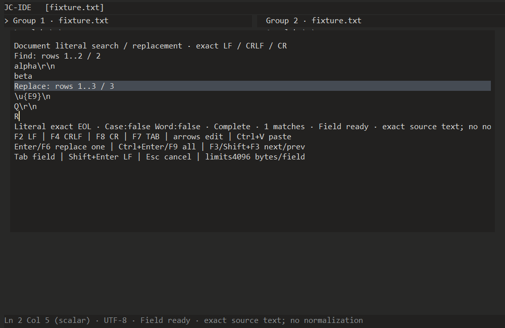

# M2 — Invisibles y bloques literales multilínea

Bloque integrado TUI/GUI sobre el mismo Workbench. Incluye el trabajo de clipboard
y elección de encoding que estaba en curso. No incorpora regex ni dependencias.
La evidencia local de cierre se añade después de construir las rutas completas.

## Mostrar caracteres invisibles

View / Show Invisible Characters, Command Palette y Ctrl+Alt+I en Editor
ejecutan `ViewToggleInvisibles`. Un bool de Workbench gobierna todos los documentos
y grupos; cada vista conserva su único caret/selección. El toggle no edita bytes,
encoding, revisión, dirty ni historial. Cambiar modo reinicia el scroll horizontal
de ambos grupos porque su unidad visual cambia; el caret fuente permanece intacto.

El modo diagnóstico usa **ASCII en ambos frontends**. Es la alternativa universal
a depender de que la fuente tenga un glifo: no se confunde carácter sin glifo con
carácter ausente. También escapa letras no ASCII; es una decisión explícita para
tener anchura cierta en este modo, sin afirmar graphemes/shaping del modo normal.

| Fuente | Representación | Span fuente |
|---|---|---|
| Espacio | `\s` | Un byte/escalar |
| TAB | `\t` y relleno `~` | Un byte, ancho4..7; próximo TAB4 tras mínimo4 celdas |
| CR | `\r` | Un byte |
| LF | `\n` | Un byte |
| CRLF | `\r\n` | Un solo span de2 bytes |
| C0, DEL | `\xNN` hexadecimal mayúscula | Un escalar |
| Barra invertida | `\\` | Un escalar, evita ambigüedad con escapes |
| Todo no ASCII | `\u{HEX}` | Un escalar en su encoding fuente |
| Bytes inválidos | `\xNN` por byte | El grupo inválido completo permanece atómico |

NBSP=`\u{A0}`, BOM inicial/interior=`\u{FEFF}`, zero-width, bidi, separadores
Unicode y combinantes son identificables por su código. Los indicadores se
distinguen además por estilo dim; selección tiene prioridad visual. CR/LF reales
siguen definiendo filas; sus indicadores se dibujan al final de la fila anterior.
Unicode U+2028/U+2029 se muestra como escape, sin inventar un EOL de archivo.

Cada celda preparada contiene un rango de bytes fuente y un indicador de estilo.
Todas las celdas de un escape/TAB/CRLF apuntan al mismo span, sin offsets ficticios.
Caret byte→columna usa el inicio del span; EOL es posición anterior al indicador.
Click en cualquier celda del indicador vuelve al inicio fuente; CRLF+1 se rechaza.
El BOM inicial se muestra antes de la primera posición editable; click ahí ajusta
al byte3. Scroll horizontal recorta celdas de display, incluso dentro de un escape,
conservando su rango fuente para selección/búsqueda. No se iguala escalar a columna.

Rectángulos conservan su geometría TAB4 original para copiar/editar. Su caret
interno TAB suma el desplazamiento lógico al inicio del indicador; el ancho mínimo4
evita colapsarlo. TAB seleccionado parcialmente resalta el indicador entero,
no inventa una selección de bytes parcial. Las columnas virtuales se muestran
como espacio de viewport después del EOL; no tienen fuente ni se copian marcas.
El resaltado de padding virtual no está completo; no se declara selección gráfica
general por píxel/grafema. La operación real conserva su selección original.

## Rangos y cuotas

El mapa diagnóstico se comparte por documento; no posee otra copia editable.
Escanea líneas frías con fragmentos4096+4 y checkpoints dispersos byte/escalar/
display. Lecturas cálidas reanudan desde checkpoint. Retención128KiB/documento,
64 líneas y2048 checkpoints/línea como máximos; filas devueltas hasta4096 celdas.
Un cambio de revisión/encoding invalida este cache: la siguiente visita puede
volver a escanear la línea completa, con buffers acotados. No reconstruye todo el
documento ni se afirma latencia constante de una línea fría enorme.

El cache textual anterior queda en896KiB: sumado al diagnóstico128KiB conserva
1MiB lógico de layouts por documento. Metadatos de líneas se contabilizan aparte;
esto no garantiza RAM privada. GDI/terminal consumen presentaciones de solo lectura.

## Buscar y reemplazar bloques de documento

Ctrl+F/Ctrl+H, Search y Palette abren campos multilínea reales en TUI y GUI.
Se puede pegar, mover el caret, insertar o borrar dentro del patrón y reemplazo.
El patrón completo es navegable: las filas visibles siguen al caret, con contadores
de fila y escapes ASCII para controles/Unicode. El estado del campo usa offsets
UTF8; CRLF se mueve/borra como una unidad. No es un caret de bytes del documento.

| Gesto | Acción en los campos |
|---|---|
| Paste terminal / Ctrl+V GUI | Insertar bloque exacto en el caret |
| F2 / Shift+Enter / Alt+Enter | Insertar LF, sin ejecutar |
| F4 | Insertar CRLF |
| F8 | Insertar CR |
| F7 | Insertar TAB |
| Flechas, Home/End, Backspace/Delete | Editar/navegar el campo |
| Ctrl+U | Vaciar el campo activo |
| Tab / Shift+Tab | Cambiar Find/Replace |
| F3 / Shift+F3 | Siguiente/anterior |
| Enter / F6 en Replace | Reemplazar uno |
| Ctrl+Enter / F9 en Replace | Reemplazar todos |
| Escape | Cerrar/cancelar |

En Find, Enter busca siguiente. Si el terminal no distingue modificadores de
Enter, usar F2 para LF y F9 para Replace All. En TUI también siguen las opciones
Case/Word e historial existentes. No se implementa regex ni normalización Unicode.

**EOL exacto:** LF, CR y CRLF son patrones distintos. `\n` escrito como barra+n
es texto literal; F2 o paste insertan el salto real. Un LF solo no coincide con
el interior de CRLF. Los saltos del reemplazo son los introducidos/pegados, sin
convertir al EOL preferido del documento. Bytes externos al match, BOM y salto
terminal se conservan. Encoding estricto rechaza caracteres no representables.

Cada campo admite4096 bytes UTF8; una inserción excesiva se rechaza completa.
Replace All conserva la cuota agregada2MiB del motor. Se ejecuta sobre resultados
completos/vigentes del documento y publica un `apply_text_edits` con un undo.
No hay undo global de proyecto ni nuevo ámbito. Revisión/generación/caret diferido
siguen los contratos S0. En GUI un TASKS_MESSAGE procesa un slot cooperativo y
reprograma si queda trabajo: no escanea todo en WM_CHAR ni en la pintura.

## Clipboard y encoding

Copy/Cut/Paste lineales GUI usan CF_UNICODETEXT únicamente por acción explícita,
sin leer disponibilidad/contenido durante render, startup o polling. Workbench
exporta una selección acotada sin tocar bytes; el frontend suelta su préstamo antes
de llamar a Windows. Cut elimina solo tras publicar correctamente y revalidar
documento/vista/revisión/encoding/caret/anchor. Paste revalida igual y usa insert_text
en una transacción. Nunca copia marcas del modo invisibles.

Adaptador UTF16 estricto: máximo2MiB de bloque nativo incluyendo terminador y
padding, y2MiB UTF8 por separado. Source/UTF8 del export también se acotan. NUL
interior no cabe en CF_UNICODETEXT: Copy/Cut lo rechaza antes de eliminar. Lectura
rechaza UTF16 inválido, falta de terminador o datos no cero tras NUL; esa regla es
conservadora y puede rechazar productores con padding no inicializado. No reintenta
en busy loop. Delayed rendering de Windows no tiene deadline duro aquí. Empty/
SetClipboardData no son transacción rollback de los formatos del dueño anterior.

Rectángulos conservan clipboard interno y undo ya implementados; no se porta su
metadata al OS en este bloque. Su Paste interno tiene prioridad hasta una nueva
copia lineal. No se declara interoperabilidad rectangular entre aplicaciones.

File / Choose Source Encoding, Palette y Ctrl+Alt+E abren la elección gráfica
UTF8/Windows1252/ISO8859-1/IBM850. Archivos de encoding desconocido abren el selector
sin escoger por el usuario. Enter interpreta los bytes existentes; Escape cancela.
No hay transcodificación/guardado ni cambio de revisión/dirty/undo por elegir.
La página legacy real de Juan sigue sin confirmarse. La TUI reutiliza su selector.

## Validación y límites

Se construye el bloque antes de su ventana serial de tests, Clippy/release y smoke.
El smoke usa HWND/fixtures propios y transporte clipboard en memoria, atravesando
los mismos contratos/handlers; no lee ni sustituye el clipboard del usuario. Las
pruebas puras UTF16 no equivalen a interoperabilidad OS real. Resultados observados
y fallos concretos se consignan al cierre, sin usar perfiles globales como bloqueo.

Manual/IME/DPI/accesibilidad y latencia física quedan para Juan al final, sin pedir
esa prueba ahora. El modo normal conserva las limitaciones previas de ancho por
escalares; el modo diagnóstico ASCII no certifica un motor completo de Unicode.

## Cierre observado — 2026-11-02

Las tres funciones están conectadas en TUI y GUI, junto con clipboard/encoding.
**376 pruebas Rust distintas aprobadas** mediante cierre selectivo:119 en las
suites completas iniciales,86 al completar jc-app y171 en los otros crates. No
es una corrida única376. Dos helpers de subprocess se invocan desde sus padres.

La integración detectó dos errores de compilación (privacidad de método interno
y nombre sombreado), corregidos antes de ejecutar las suites; un fixture nuevo
asumía el caret de EOF y se corrigió para situarlo explícitamente. Se continuaron
las suites pendientes sin repetir las ya aprobadas. Formato, Clippy workspace
all-targets -D warnings y release workspace bins/examples aprobaron. El ajuste
final de feedback tras cuota se cerró solo con Clippy/build de los frontends y
smoke nativo; no se repitió la suite global por status/documentación.

TUI E2E real Event::Paste/teclado: bloques UTF8+BOM, LF/CRLF/CR/mixtos, controles,
Unicode, EOF/nohit, patrón y sustitución de distinto número de líneas, navegación
de campos/CRLF atómico, rechazo de paste4097, CP1252 estricto, un undo/redo y
guardado exacto. Cuatro casos de invisibles cubren View/Palette, selección por
spans, TAB/Unicode/CRLF, rectángulo parcial, resize45/140 y composición inmutable.

GUI release: **29 checks nativos aprobados** sobre HWND oculto propio, incluyendo
interpretación/cancelación de encoding sin modificar revisión/undo/dirty, spans
CRLF, toggle sin perder drafts, paste de bloque→match multilínea→reemplazo en un
undo→save UTF8/EOL exacto→undo/save original, nohit, gestos LF/CRLF/CR/TAB, cuota
atómica y pintura GDI.13 bytes originales finales intactos; errores de pintura0.
wall_ms=18 mide duración de automatización, no latencia física. Dos canvas GDI
1000x650 revisados; clipboard real no se abrió ni modificó.

- [Reporte nativo exacto](evidence/m2-visible-blocks-native-report-2026-11-02.json).
- [Logs locales completos de este cierre](evidence/m2-visible-blocks-validation-2026-11-02.log).
- [Hashes de fuentes/binario/fixtures/bitmaps y conteo](evidence/m2-visible-blocks-metadata-2026-11-02.json).
- [Invisibles en dos vistas](evidence/m2-invisibles-native-2026-11-02.png).
- [Campos multilínea nativos](evidence/m2-multiline-native-2026-11-02.png).

Interoperabilidad clipboard OS, IME/DPI/accesibilidad, diálogos físicos y aceptación
global permanecen abiertas. No se solicita prueba manual ahora. Los bloques
pedidos se construyeron antes de esa aceptación; no se descargaron dependencias,
no hubo CI/push ni nuevos perfiles globales. Save All GUI sigue requiriendo su
flujo explícito y no guarda untitled por shortcut: es el próximo pendiente M2B.
